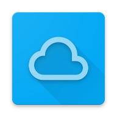

  

<h1 align="center">AClouDroid</h1>

  <b>在 Android 上访问你的 iCloud —— 照片、视频、云盘！不需要 iPhone ，不需要 iPad ，也不需要开电脑</b>

  
  
  
  

  <a href="https://github.com/CuteCatGYH/iClouDroid/releases">下载安装</a> · <a href="https://github.com/CuteCatGYH/iClouDroid/issues">问题反馈</a>

---

## ✨ 功能特性

**📷 浏览你的 iCloud**
登录 Apple ID，在 Android 上查看 iCloud 中的照片库、云盘文件。支持月分组视图、年月快速跳转、全屏预览与 EXIF/GPS 元数据查看。

**🔄 本地相册自动备份至 iCloud**
支持后台增量上传照片和视频至 iCloud。自动识别 Motion Photo（安卓动态照片），以 Apple 原生 Live Photo 格式无损写入；内置本地指纹与云端双重查重，可避免重复上传。

**📸 Live Photo ↔ Motion Photo 双向互转**
- **下载**：iCloud Live Photo → Google Motion Photo
- **上传**：本地 Motion Photo → Apple Live Photo

**📁 iCloud Drive 云盘**
浏览、上传、下载、新建、删除、重命名、移动文件。支持查看 iWork 文档。

**📱 系统集成**

- 接入系统文件选择器，可从任意支持系统文件选择器的 APP 中直接访问 iCloud 内容
- 接入系统分享菜单，现可直接使用系统分享功能将文件上传至 iCloud Drive / iCloud Photo
- 支持 Android 13+ `CloudMediaProvider`。在微信、小红书等第三方 App 选图时，可直接选择 iCloud 照片与视频。

**🎨 原生 Android 体验**
Material 3 设计，支持 Android 12+ Monet 动态取色与深浅色外观。

---

## 🚀 开始使用

1. 安装并打开 APP，选择账号区域（中国大陆 / 国际区）
2. 使用 Apple ID 登录（记得勾选「信任此浏览器」）
3. 一键提取 Cookie 后即可开始浏览与同步
4. **可选**：进入「设置 → 系统整合」，通过 Shizuku 授权激活云端媒体提供方

---

## 📊 功能状态

| 功能 | 状态 |
| --- | --- |
| iCloud 登录（国区 / 国际区） | ✅ |
| 照片与视频浏览（日视图 / 月视图） | ✅ |
| 月分组 + 年月快速跳转 | ✅ |
| EXIF 元数据查看 | ✅ |
| Live Photo 下载自动转换为 Motion Photo | ✅ |
| 本地相册自动备份上传 | ✅ |
| Motion Photo 上传自动转换为 Live Photo  | ✅ |
| 系统 PhotoPicker 集成 (Android 13+) | ✅ |
| 定时周期扫描与全量对账 | ✅ |
| iCloud Drive 文件管理 | ✅ |
| 动态 Monet 取色与深/浅色外观 | ✅ |
| 备忘录、提醒事项… | 计划中 |

---

## ❓ 常见问题

**Q：我的密码安全吗？**
登录完全通过本地 WebView 进行，与浏览器登录 icloud.com 一致。App 仅加密保存 Apple 颁发的会话凭证（Cookie/Token），不上传任何密码

**Q：第一次加载为什么要等一会？**
首次需要从 iCloud 读取全部数据索引。App 支持后台扫描，你可以先浏览已加载的内容

**Q：设置要在哪里才能找到？**
设置选项在“照片”页面右上角的账号信息按钮里哦

**Q：遇到 bug 该怎么反馈**
请前往『设置-关于』中导出日志，并前往 [Issues](https://github.com/CuteCatGYH/AClouDroid/issues) 页面提交反馈

---

## 📌 注意事项

- 在 iPhone/Mac 上新拍的照片需上传至 iCloud 并在 AClouDroid 触发同步后才会呈现
- 开启自动备份时，建议将 AClouDroid 的电池优化设为「不受限制」，可在设置内调整备份相关选项。

---

## 🤝 致谢

本项目在开发过程中参考了以下开源项目：

- [rclone/rclone](https://github.com/rclone/rclone) — HTTP 会话与网络通信底座
- [icloud-photos-downloader/icloud_photos_downloader](https://github.com/icloud-photos-downloader/icloud_photos_downloader) — CloudKit 协议结构与字段对照参考

---

## 📜 License

This project is licensed under the [GNU General Public License v3.0](LICENSE).

---

> **免责声明**：本项目为个人开发的第三方开源客户端，与 Apple Inc. 无任何关联。
> 使用前请确保你了解并遵守 iCloud 的使用条款，并自行承担账号与数据相关风险。
